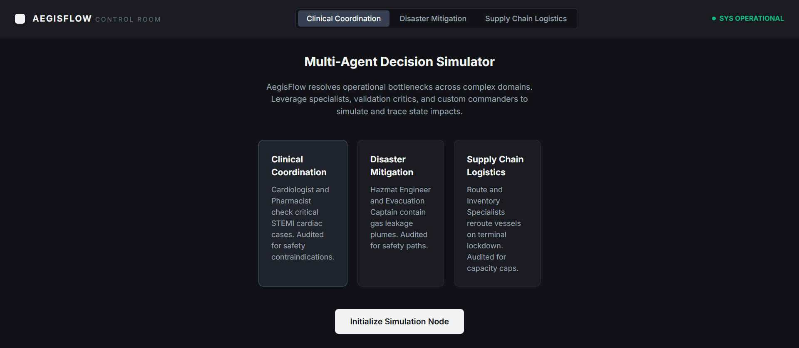

# AegisFlow — Multi-Agent Operational Decision Simulation Platform

AegisFlow is a production-oriented, multi-domain AI orchestration platform that models, simulates, and audits multi-agent operational decision workflows. It coordinates specialist LLM agents through a structured workflow graph engine with safety critics, telemetry feedback, and human-in-the-loop override controls.

---

## Architecture

```
multiagent-sim/
├── apps/
│   ├── api/          # FastAPI backend — session lifecycle, orchestration routing
│   └── web/          # Next.js 15 dashboard — React 19, vanilla CSS
├── packages/
│   ├── agents/       # Agent role definitions, scenarios, domain configs
│   ├── evaluation/   # Confidence scoring and safety grading
│   ├── orchestration/ # Workflow graph engine + Gemini SDK integration
│   ├── shared_types/ # Pydantic models shared across backend
│   └── state_engine/ # Deterministic state transition rules
├── .env              # API keys (GEMINI_API_KEY)
├── Makefile          # Build/run shortcuts (Linux/macOS)
└── docker-compose.yml
```

### Workflow Graph Pipeline

Every simulation request flows through six sequential nodes:

1. **CONTEXT_PREP** — Serialize current domain state, metrics, and active directives
2. **PROPOSAL_GENERATION** — Two specialist agents generate recommendations in parallel
3. **CRITIC_REVIEW** — Safety critic audits proposals for violations and assigns confidence score
4. **RESOLVE_CONSENSUS** — Orchestrator reconciles conflicts into a single resolved command
5. **STATE_MUTATION** — Deterministic rules engine applies the decision to telemetry state
6. **COMMIT_LOGS** — Pipeline timing and events appended to the session audit trail

---

## Simulation Domains

| Domain | Agent Roles | Key Metrics |
|:---|:---|:---|
| **Clinical Triage** | Cardiologist, Pharmacist, Clinical Critic, Director | Heart Rate, SpO2, BP, Pain, Stability |
| **Disaster Response** | Hazmat Engineer, Evac Captain, Safety Auditor, Commander | Plume PPM, Containment %, Evacuation %, Casualties |
| **Supply Chain** | Route Planner, Inventory Planner, Risk Critic, Ops Director | Cargo Backlog, Transit Delay, Storage %, Idle Ships |

---

## Setup

### Prerequisites

- Python 3.11+
- Node.js 18+
- Gemini API Key (optional — runs in sandbox mode without one)

### Quick Start (PowerShell on Windows)

```powershell
# 1. Install Python dependencies
pip install -r apps/api/requirements.txt

# 2. Install frontend dependencies
cd apps/web
npm install
cd ../..

# 3. Configure API key (create .env in project root)
#    Add: GEMINI_API_KEY=your_key_here
#    The server auto-loads .env — no manual export needed.

# 4. Start the API server (Terminal 1)
python apps/api/main.py

# 5. Start the web dashboard (Terminal 2)
cd apps/web
npm run dev
```

### Quick Start (Linux/macOS with Make)

```bash
make install      # Install all dependencies
make run-api      # Start FastAPI server (port 8000)
make run-web      # Start Next.js dev server (port 3000)
```

Open `http://localhost:3000` in your browser.

## Demo screenshot



---

## API Key & SDK

AegisFlow uses the official `google-genai` Python SDK with `gemini-3-flash`.

- Set `GEMINI_API_KEY` in the root `.env` file — auto-loaded by the server
- Without an API key, the platform runs in **sandbox mode** with high-fidelity deterministic responses
- With an API key, specialist agents make live LLM calls via `google.genai.Client`

---

## Testing

```powershell
# Unit tests (state engine + scoring)
python -m unittest packages.rules_test

# Full E2E verification (requires API server running on port 8000)
python packages/rules_test.py
```

---

## Docker Deployment

```bash
docker-compose build
docker-compose up -d    # API on :8000, Web on :3000
docker-compose down
```

---

## Key Engineering Decisions

- **Official SDK integration** — `google-genai` is used natively so live Gemini calls remain current and maintainable.
- **Async orchestration** — FastAPI and asyncio enable concurrent specialist proposal generation without blocking I/O.
- **Deterministic workflow graph** — Explicit state transition rules make simulation outcomes reproducible and auditable.
- **Configurable environment strategy** — `python-dotenv` for local development, with `os.environ` fallback for container and production deployments.
- **Schema-first contracts** — Shared Pydantic and TypeScript schemas enforce consistency across backend and frontend.
- **Container-friendly deployment** — Docker Compose isolates API/web services and supports a scalable local dev workflow.
- **Safety-first controls** — Built-in critic review, human override, and structured audit trails support safe operational decisioning.
